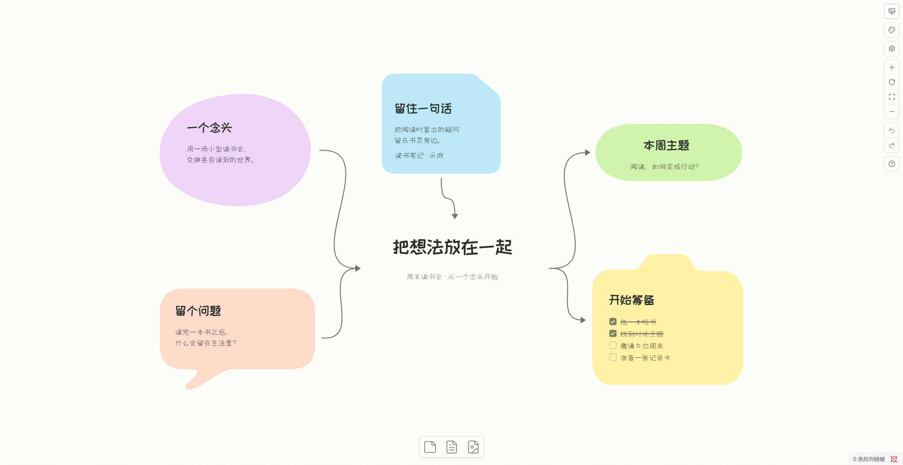
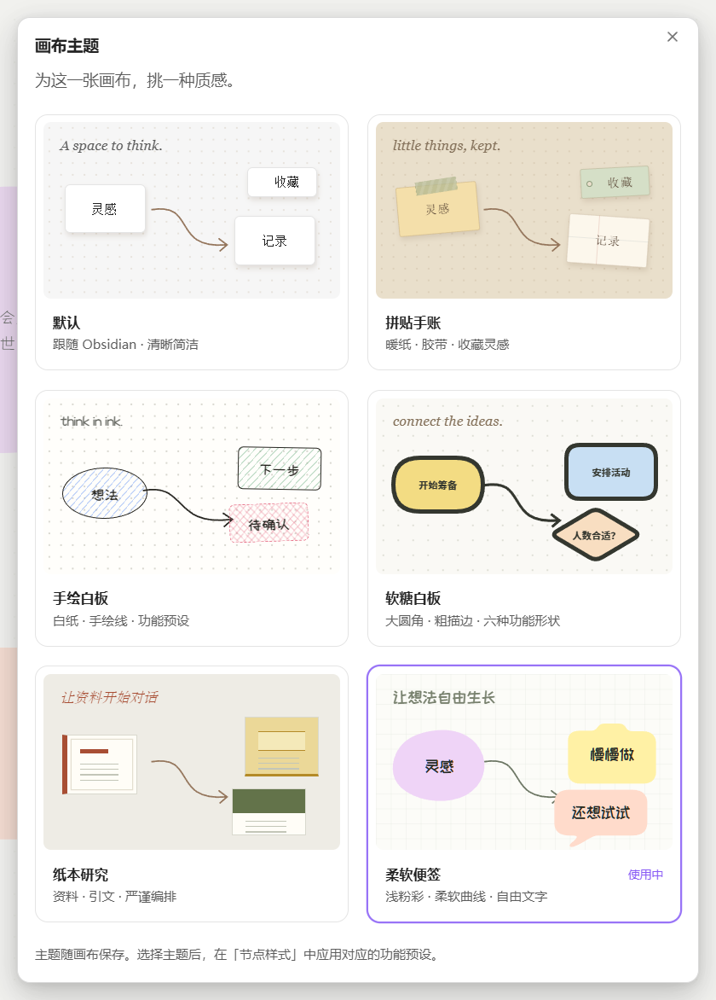
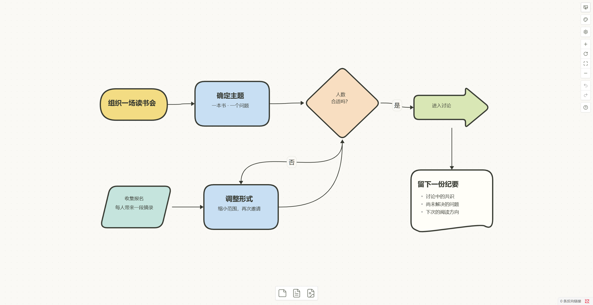
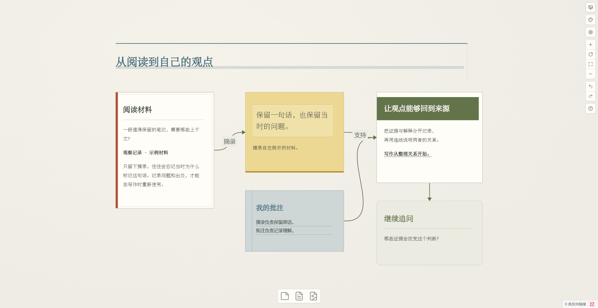
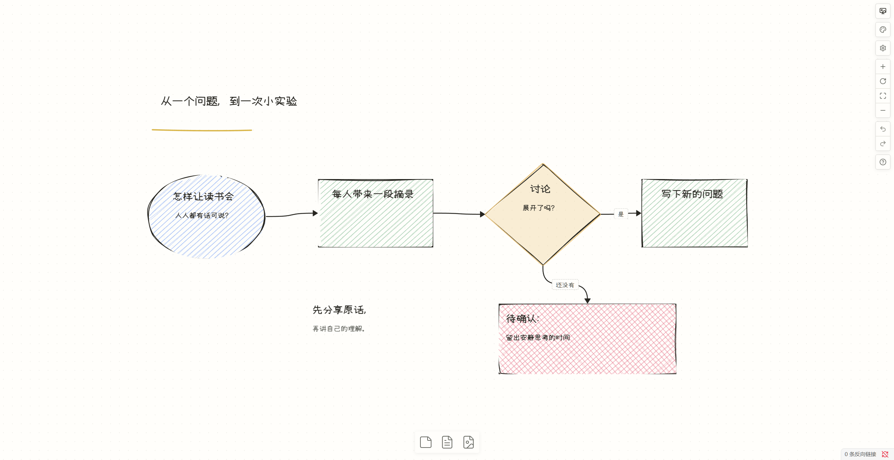
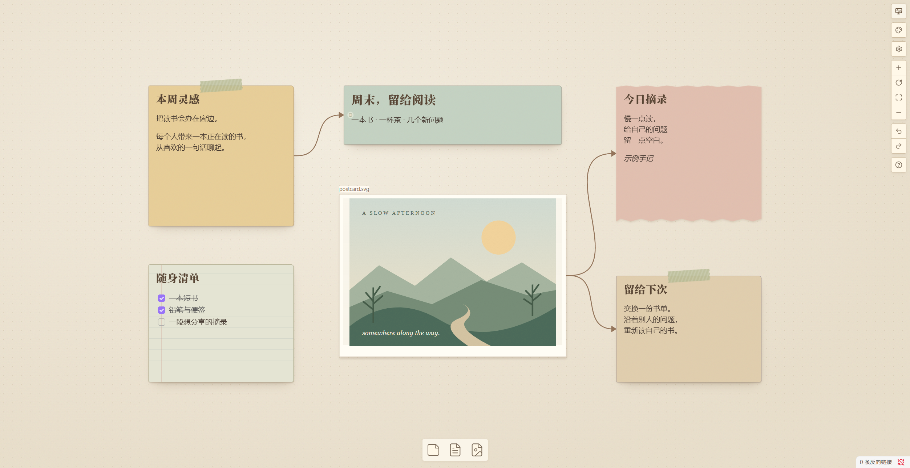
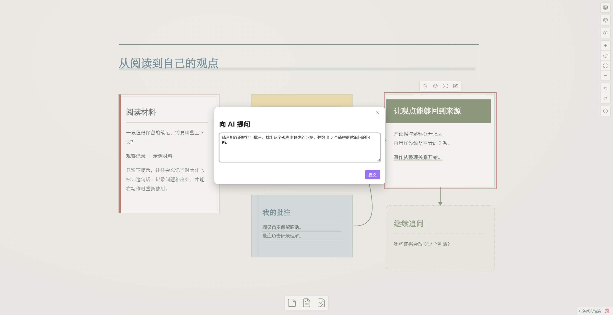

<h1 align="center">Better Canvas</h1>

<p align="center">
  <strong>在 Obsidian 里，把想法整理成图。</strong>
</p>

<p align="center">记录灵感 · 梳理流程 · 阅读批注 · 关联 AI</p>

<p align="center">
  
  
</p>

<p align="center">
  <a href="#安装">安装</a> ·
  <a href="#选一种适合内容的画布">画布主题</a> ·
  <a href="#从第一张卡片开始">开始使用</a> ·
  <a href="docs/FEATURE_GUIDE.md">功能指南</a>
</p>



Better Canvas 是 Obsidian Canvas 的增强插件。用卡片收集零散想法，用连线表达关系，再把内容整理成思维导图、流程图或阅读工作台。需要继续分析时，可以向 AI 提问，并把回答留在来源旁边。

**画布编辑和主题无需配置 AI。** 内容仍保存在 Vault 的 `.canvas` 文件中。

*截图来自 Windows / Obsidian 1.14.4 的真实界面。示例内容可在[示例画布](docs/examples/readme-showcase/)中取得；采集与验证范围见[截图说明](docs/screenshots/README.md)。*

## 选一种适合内容的画布

每张画布可以单独选择主题。点击画布右侧的 **画布主题**，再从 **节点样式** 中选用配套预设。切换主题保留已有内容和位置，主题选择随画布保存。

<p align="center">
  
</p>

首图使用 **柔软便签**：用浅彩曲线区分灵感、摘录、概念、行动和问题。自由文字适合放标题，行动卡可以直接使用 Markdown 任务清单。

<table>
  <tr>
    <td width="50%" valign="top">
      <h3>软糖白板 · 规划流程</h3>
      <p>用胶囊表示起止，用菱形提出判断，用文档卡收束结果。</p>
      <a href="docs/screenshots/rounded-map.png"></a>
    </td>
    <td width="50%" valign="top">
      <h3>纸本研究 · 从材料到观点</h3>
      <p>把原文、重点引文、阅读批注和自己的观点放在一起。</p>
      <a href="docs/screenshots/research.png"></a>
    </td>
  </tr>
  <tr>
    <td width="50%" valign="top">
      <h3>手绘白板 · 推敲一个想法</h3>
      <p>用手绘轮廓、排线和旁注，表达概念、步骤与待确认事项。</p>
      <a href="docs/screenshots/sketch.png"></a>
    </td>
    <td width="50%" valign="top">
      <h3>拼贴手账 · 收藏阅读片刻</h3>
      <p>把图片、摘录和清单放进胶带便签、横线纸与照片框。</p>
      <a href="docs/screenshots/scrapbook.png"></a>
    </td>
  </tr>
</table>

喜欢 Obsidian 原有外观，可以继续使用 **默认** 主题。共 6 种主题，适合不同的内容和表达方式。点击图片可查看大图。

## 一边输入，一边展开思路

选中卡片后，按 `Tab` 创建子节点，按 `Enter` 创建同级节点。编辑文字时，改用 `Shift + Tab` 和 `Shift + Enter`，可以继续扩展当前想法。


- **整理结构：** 运行“自动整理思维导图”，按左、右、上、下方向布局。
- **减少手动调整：** 新建文本卡片默认随内容调整尺寸；手动拖动角点后停止自动调整。
- **从笔记开始：** 将 Markdown 文件的一级标题拆成节点，再继续补充。
- **沿着关系浏览：** 用 `Alt + 方向键` 选择相邻卡片，或用焦点模式突出当前内容。

### 让卡片表达不同的意思

选中一个或多个节点，点击画布右侧的 **节点样式** 调色板按钮。

- 先选组合预设，再按需调整颜色、形状和边框。
- 文字可以靠左、居中或靠右显示。
- 多选卡片可以批量应用样式；预设不替换正文。
- 连线可以设置颜色、线型、箭头和路径，说明卡片之间的关系。

各主题提供的选项不同。例如，柔软便签保持无边框，纸本研究提供纸面色彩浓度。详细操作见[节点样式指南](docs/FEATURE_GUIDE.md#节点样式面板与默认尺寸)。

## 沿着笔记继续问 AI

选中节点，通过右键菜单或命令面板打开 **向 AI 提问所选节点**。插件将所选节点及关联上下文交给配置的服务，并把回答保存为连接到来源的新节点。



*图中展示提问入口，未提交请求，也未生成模型回答。*

- **继续推敲：** 总结材料、比较观点、寻找遗漏，支持流式回答、停止和重新生成。
- **辅助学习：** 生成闪卡，或导出 Spaced Repetition 兼容卡组。
- **处理素材：** 导入网页正文，或用支持相应能力的模型分析 PDF 页面、生成图片。
- **选择服务：** 支持 OpenAI-compatible、Anthropic 和 Gemini；桌面端也可使用已安装并登录的 Codex CLI 或 OpenCode ACP。
- **连接外部工具：** 按需配置 MCP 工具、资源和提示模板。

AI 功能需要单独配置，能力取决于服务和模型。提示词与所需上下文会发送给所配置的服务；本地 CLI 也可能调用远程模型。配置方法见 [AI 与 MCP 指南](docs/AI_SETUP.md)。

## 整理之后，继续使用

| 想完成的事 | 可以使用的功能 |
| --- | --- |
| 收起暂时不看的内容 | 分组与折叠、焦点模式 |
| 把大画布拆成几个主题 | 将选区封装为新 Canvas；用 Portal 引用另一张画布 |
| 让笔记与画布互相连接 | 节点链接、Canvas 链接与反向链接浏览 |
| 边读 PDF 边记录 | 固定页面、提取摘录、画笔与高亮；按页码范围识别文字（AI OCR） |
| 向别人说明思路 | 演示模式；导出全画布、当前视口或选区的 PNG / SVG |

主题的静态导出效果可能与编辑界面不同。拼贴手账的纸纹和胶带等装饰暂不在全画布、选区静态导出中还原。详细范围见[功能指南](docs/FEATURE_GUIDE.md)和[已知限制](docs/KNOWN_LIMITATIONS.md)。

## 安装

### 下载正式版

1. 打开 [GitHub Releases](https://github.com/OneLastHuman/obsidian-better-canvas/releases)。
2. 下载 `obsidian-better-canvas.zip`。
3. 将压缩包解压到 Vault 的 `.obsidian/plugins/` 目录。
4. 在 Obsidian **设置 → 社区插件** 中重新加载插件列表。
5. 启用 **Better Canvas**。

插件目录应包含以下文件：

```text
<Vault>/.obsidian/plugins/obsidian-better-canvas/
├── main.js
├── manifest.json
└── styles.css
```

### 体验主分支构建

本页介绍当前源码中的功能，正式版可能尚未包含全部更新。要体验主分支构建，将以下 3 个文件放入上述插件目录，再重新加载插件：

- [main.js](https://raw.githubusercontent.com/OneLastHuman/obsidian-better-canvas/main/release/main.js)
- [manifest.json](https://raw.githubusercontent.com/OneLastHuman/obsidian-better-canvas/main/release/manifest.json)
- [styles.css](https://raw.githubusercontent.com/OneLastHuman/obsidian-better-canvas/main/release/styles.css)

[`release/`](release/) 由成功的主分支 Build workflow 自动同步。主分支构建与正式版的区别、Actions 工件下载和源码构建方法见[安装指南](docs/INSTALLATION.md)。

## 从第一张卡片开始

1. 新建或打开一个 Obsidian Canvas。
2. 点击右侧 **画布主题**，选择适合内容的主题。
3. 添加文本卡片，写下一个想法。
4. 选中卡片，在 **节点样式** 中选择预设。
5. 按 `Tab` 添加子节点，继续展开。

也可以把[示例画布](docs/examples/readme-showcase/)复制到 Vault，直接编辑截图中的内容。

插件设置分为 **画布、操作、AI 助手、文件** 4 类。可以设置布局间距、快捷键、模型服务和导出选项。修改后点击 **保存更改** 生效，或点击 **放弃更改** 恢复已保存设置。

### 常用快捷键

| 快捷键 | 操作 |
| --- | --- |
| `Tab` / `Enter` | 未编辑文字时，创建子节点 / 同级节点 |
| `Shift + Tab` / `Shift + Enter` | 编辑文字时，创建子节点 / 同级节点 |
| `Alt + ↑ / ↓ / ← / →` | 选择空间位置相邻的节点 |
| `Ctrl/Cmd + Shift + 方向键` | 按指定方向创建子节点 |

快捷键可在 **设置 → Better Canvas → 操作** 中按组关闭。

## 兼容性与数据

- **版本：** 最低要求为 Obsidian 1.5.0。部分功能依赖内部 API；较新主题的实机截图来自 1.14.4，不代表所有版本均已验证。
- **设备与外观：** 移动端、第三方 Obsidian 主题和复杂画布仍有待验证的行为。非矩形卡片的连线端点、框选与缩放范围仍按原生矩形边界工作。
- **Portal 与 PDF：** Portal 主要支持单层同步。PDF 批注保存在 Canvas 中；完整的原生 PDF 高亮编辑和多页批注管理尚未完成。
- **AI 与工具：** 使用前确认服务的数据处理政策。MCP 本地 stdio 服务以当前用户权限运行，只应连接可信服务，并在执行前检查工具参数。
- **HTML 预览：** 使用沙盒 iframe；只预览可信或已检查的代码。

逐项实现与验证状态见[功能整合矩阵](docs/INTEGRATION_MATRIX.md)。配置、限制、自定义样式与其他专题见[文档索引](docs/README.md)。

## 开发

需要 Node.js 22 和 npm。在源码目录执行：

```bash
npm install
npm run lint
npm run validate:metadata
npm run typecheck
npm test
npm run build
```

将生成的 `main.js` 与 `manifest.json`、`styles.css` 复制到插件目录。`npm run dev` 用于开发构建。

测试分层和桌面验证要求见[测试规范](docs/TESTING.md)，提交与审查约定见[仓库治理](docs/REPOSITORY_GOVERNANCE.md)，版本发布见[发版流程](docs/RELEASING.md)。

## 致谢与许可证

部分功能方向参考了 [Advanced Canvas](https://github.com/Developer-Mike/obsidian-advanced-canvas)、[Canvas MindMap](https://github.com/Quorafind/Obsidian-Canvas-MindMap) 和 [Obsidian AI Canvas](https://github.com/testy-cool/obsidian-ai-canvas)。

本项目使用 [GPL-3.0-or-later](LICENSE) 许可证。上游来源和第三方资源说明见[致谢文档](docs/ACKNOWLEDGEMENTS.md)。
