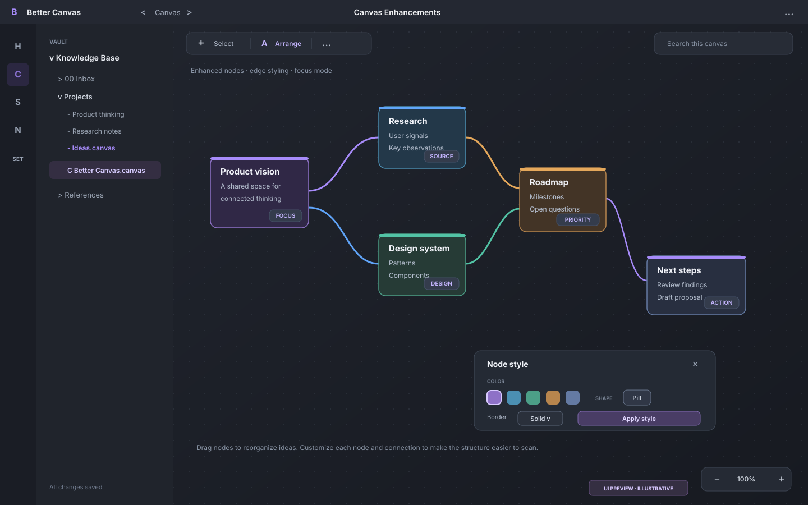
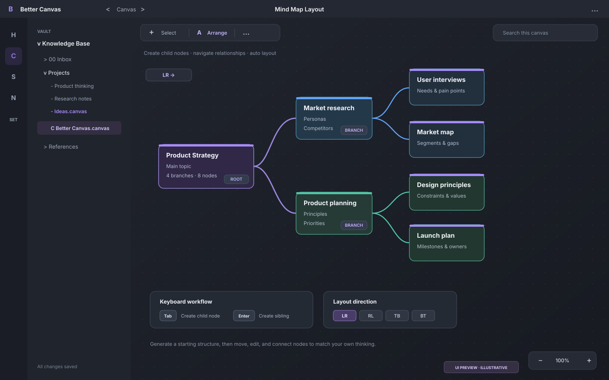
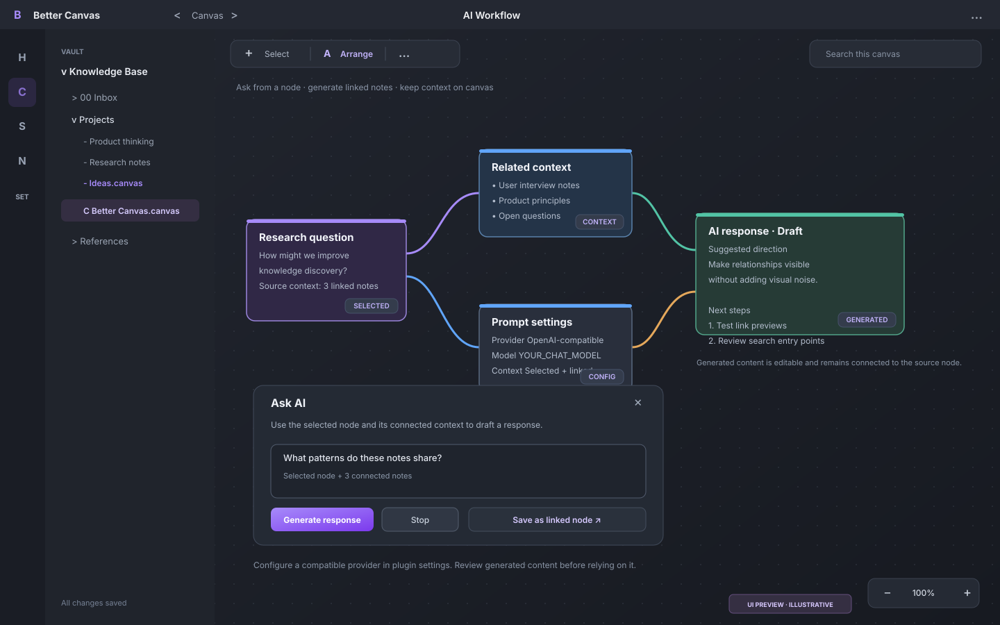

# Better Canvas

<p align="center">
  <strong>为 Obsidian Canvas 增加节点编辑、思维导图和 AI 工作流。</strong>
</p>

<p align="center">
  
  
</p>

Better Canvas 为 Obsidian Canvas 增加节点与连线编辑、思维导图、知识关联和可配置的 AI 工作流。你可以在画布中整理资料、建立节点关系，并将 AI 生成的内容保存为可继续编辑的节点。

> **项目状态：** 当前项目仍在持续整合和验证中。部分功能依赖 Obsidian 的内部 API 或特定渲染行为，代码已实现不代表已在所有 Obsidian 版本、桌面端和移动端完成验证。请参考[功能整合矩阵](docs/INTEGRATION_MATRIX.md)了解具体覆盖状态。

## 目录

- [界面预览](#界面预览)
- [功能概览](#功能概览)
- [安装](#安装)
- [MCP 工具配置](#mcp-工具配置)
- [本地 OpenCode ACP](#本地-opencode-acp)
- [本地 Codex CLI](#本地-codex-cli)
- [AI 服务配置](#ai-服务配置)
- [快捷键](#快捷键)
- [开发与验证](#开发与验证)
- [已知限制](#已知限制)
- [上游项目与致谢](#上游项目与致谢)
- [许可证](#许可证)

## 界面预览

以下图片是根据当前功能范围制作的界面示意图，并非 Obsidian 实际运行截图。实际外观可能因 Obsidian 版本、主题和服务配置而异。

<p align="center">
  
</p>

<table>
  <tr>
    <td width="50%" valign="top">
      <strong>思维导图与自动布局</strong><br />
      
    </td>
    <td width="50%" valign="top">
      <strong>AI 辅助工作流</strong><br />
      
    </td>
  </tr>
</table>

## 功能概览

### Canvas 增强

- **节点样式：** 自定义颜色、形状、边框、文本对齐和 CSS 类。
- **连线控制：** 设置颜色、线型和箭头样式，翻转关联边的方向，自动重定位 floating edges，并为选中连线选择 direct、square 或 A-star 路径。
- **布局与专注：** 网格对齐、文本节点自动调整尺寸、层级排序、焦点模式、交互锁定及基础路径路由。
- **日常工作流：** 搜索画布中的文本、文件路径和链接；查看当前 Canvas 的外链与反向链接，或将唯一目标批量添加为文件、网页或文本节点；按左/右/上/下方向克隆所选节点并自动连接；保存节点模板；按节点顺序进入演示模式。
- **组织与导出：** 创建独立分组、折叠/展开分组、将选区封装为独立 Canvas，并导出 JSON Canvas、视口 PNG/SVG，以及按所有节点边界导出的全内容 PNG/SVG。后者使用静态 SVG 渲染流程图形状、文字、连线与箭头，保留 direct、square 和 A-star 路由，并在体积预算内嵌入 PNG/JPEG/WebP/GIF 图片和 PDF 页面栅格预览（固定页面使用对应页码，普通 PDF 节点默认预览第一页）。常见 Markdown 粗体、斜体、链接、标题、任务清单和列表会转换为适合静态图像的可读文本；交互 HTML 仍以标签表示，不会运行其代码。节点模板可保存样式属性并重复使用；Canvas frontmatter 支持逐属性编辑和完整 JSON 对象批量编辑。

部分样式、分组行为和导出结果可能因画布复杂度或 Obsidian 渲染版本而异，详见[功能整合矩阵](docs/INTEGRATION_MATRIX.md)。

### 思维导图

- 创建子节点、同级节点和游离节点。
- 将 Markdown 文件中的 H1 标题拆分为关联节点。
- 选择节点树，并按 LR、RL、TB 或 BT 方向执行基础自动布局。
- 使用键盘快捷键快速创建节点、浏览相邻节点；可在设置中独立开关 Tab、Enter、Alt + 方向键和 Ctrl/Cmd + 方向键快捷键。
- 将所选节点按左、右、上或下方向克隆并连接，保留原节点内容、样式和扩展属性。
- 生成思维导图结构和复习闪卡节点；生成结果应在使用前检查。

### AI 辅助工作流

- 根据选中节点及其相邻关联内容提问，并将回答保存为连接到原节点的新节点。卡片悬停时可直接使用“AI、Img、卡片、模型”快捷按钮；AI 生成节点额外显示重新生成按钮，右键菜单和命令面板仍可使用。
- 支持流式生成、停止生成、重新生成，以及按节点覆盖模型或服务配置。
- 通过配置的服务生成图片，并将图片保存到 Vault 的附件目录后插入画布。
- 导入网页正文和可访问的 YouTube 字幕，作为后续整理与分析的素材。
- 支持远程 **MCP Streamable HTTP**、旧式远程 **SSE** 和本地 MCP **stdio** 工具调用；也可让 AI 根据可用工具描述提出工具和参数建议，用户检查并确认后才执行。stdio 通过单独配置的 command/args/env/cwd 启动本地进程，请只配置可信服务。
- 可从 OpenAI-compatible、Anthropic 和 Gemini 的模型端点发现可用模型，并为单个节点选择模型；接口不支持列出模型时仍可手动输入。
- 桌面端可调用已安装并登录的 Codex CLI，在只读沙盒中分析选中节点和相邻上下文；任务可由“停止当前 AI 生成”中断，结果保存为关联节点。
- 文本 AI 可选本机 OpenCode ACP：通过 `opencode acp` 和 stdio 上的 ACP JSON-RPC 调用 OpenCode 使用的模型与登录配置，不需要单独填写文本 API Key。
- 可选择 Vault 文件夹，对最多 20 篇 Markdown 顺序执行同一条 Prompt，逐篇创建源文件节点与结果节点；正文发送给当前 AI 供应商前会要求用户选择文件夹并确认任务。
- 识别 AI 或手写节点中的 HTML 代码块，可通过按钮在隔离的 sandbox iframe 中预览交互页面。
- 可把固定 PDF 页面提取为 AI 文本上下文，并将页面栅格图像发送给支持视觉输入的模型；支持按页码或页码范围批量 OCR（每批最多 20 页），并为每页保存独立结果节点；Gemini profile 支持对公开视频进行原生视频上下文分析。

AI 功能受服务 API、模型、账号权限和内容可访问性影响。网页反爬、登录限制、缺失字幕或不受支持的接口都可能导致操作失败。

## 安装

### 从仓库直接安装

成功的 `main` 分支构建完成后，CI 会将生产构建的 `main.js` 自动提交到仓库根目录。下载以下三个文件：

- [`main.js`（生产构建）](https://raw.githubusercontent.com/OneLastHuman/obsidian-better-canvas/main/main.js)
- [`manifest.json`](https://raw.githubusercontent.com/OneLastHuman/obsidian-better-canvas/main/manifest.json)
- [`styles.css`](https://raw.githubusercontent.com/OneLastHuman/obsidian-better-canvas/main/styles.css)

把三个文件放入 Vault 的插件目录 `<Vault>/.obsidian/plugins/obsidian-better-canvas/`，然后打开 Obsidian 的 **设置 → 社区插件**，重新加载插件列表并启用 **Better Canvas**。

首次启用这套同步流程时，`main.js` 会在该次 Build workflow 成功后提交；Pull Request 构建只验证并打包，不会写回安装产物。

### 从 GitHub Releases 安装

1. 打开 [GitHub Releases](https://github.com/OneLastHuman/obsidian-better-canvas/releases)，下载对应版本的 `obsidian-better-canvas.zip`。
2. 将 ZIP 解压到 Vault 的插件目录 `<Vault>/.obsidian/plugins/`。压缩包内已包含 `obsidian-better-canvas/` 文件夹，最终结构应为：

   ```text
   <Vault>/.obsidian/plugins/obsidian-better-canvas/
   ├── main.js
   ├── manifest.json
   └── styles.css
   ```

3. 在 **设置 → 社区插件** 中重新加载插件列表并启用 **Better Canvas**。

Releases 也会提供 `main.js`、`manifest.json`、`styles.css` 三个独立文件。

**尚未发布正式版本时：** 可以在 GitHub 的 **Actions → Build** 中打开最近一次成功的构建，下载 `obsidian-better-canvas-install` 工件。解压工件后，再解压其中的 `obsidian-better-canvas.zip` 到 `<Vault>/.obsidian/plugins/`。工件保留 14 天；正式发布后建议使用 Releases 中的版本包。

### 从源码构建

需要安装 Node.js 22 和 npm。在终端运行：

```bash
git clone https://github.com/OneLastHuman/obsidian-better-canvas.git
cd obsidian-better-canvas
npm install
npm run build
```

构建完成后，生成的 `main.js` 与项目中的 `manifest.json`、`styles.css` 一起复制到：

```text
<Vault>/.obsidian/plugins/obsidian-better-canvas/
```

## MCP 工具配置

在设置的 **Integration Features** 中选择 **MCP transport**：

- **Remote Streamable HTTP**：填写标准 MCP Streamable HTTP endpoint。
- **Remote SSE (legacy)**：填写旧式 SSE 事件流 URL（通常是服务提供的 `/sse` 地址）。可选 Bearer Token 通过 HTTPS 请求发送；插件会拒绝与配置的 SSE URL 不同 origin 的消息 endpoint。
- **Local stdio (desktop)**：填写 JSON 配置，以无 shell 的方式启动本地服务进程。示例：

```json
{
  "command": "/absolute/path/to/node",
  "args": ["/absolute/path/to/mcp-server.js", "--safe-mode"],
  "cwd": "/absolute/path/to/server",
  "env": {
    "MCP_API_TOKEN": "YOUR_LOCAL_TOKEN"
  }
}
```

`command` 是可执行文件路径，`args` 必须是字符串数组，`env` 是可选环境变量对象，`cwd` 是可选工作目录。服务列表与工具调用会各自启动一个新进程，因此 MCP 服务应能在每次启动时完成初始化。不要配置不可信的 MCP 程序：stdio 服务可以访问它自身用户权限允许的本地文件和网络。远程端点应使用可信服务器与 HTTPS。

直接调用工具前会让你检查名称和参数；使用 AI 建议工具时也必须在执行前确认。工具调用可能会修改外部系统，建议先检查参数，并仅启用你信任的服务器。

## 本地 OpenCode ACP

在 Better Canvas 设置的 **文本 AI 后端** 中选择 **本机 OpenCode ACP**。默认启动 `opencode acp`；如果 Obsidian 找不到命令，可在 **OpenCode CLI 可执行文件** 中填写绝对路径。请先在终端完成 OpenCode 安装及登录，模型与额度使用 OpenCode 自己的配置。

ACP 文本任务在系统临时目录中创建会话，不将 Vault 作为 OpenCode 工作区。此模式用于文本问答和闪卡；图片生成仍使用 API Base URL、API Key 和 Image model 配置。ACP 请求的工具或文件权限默认拒绝。ACP 后端目前只接受文本输入；如果所选节点上下文包含图片或文件，会提示切换回 API 后端以免丢失多模态内容。此模式要求桌面版 Obsidian 和本机 OpenCode CLI。

## 本地 Codex CLI

桌面版 Obsidian 可选用 **Better Canvas: 使用本地 Codex CLI 分析所选节点** 命令。需要提前安装并登录 Codex CLI；设置中的 **Local Codex CLI executable** 留空时使用 `PATH` 中的 `codex`，如果 Obsidian 找不到它，请填写绝对路径。任务在临时工作目录中以只读沙盒运行，支持“停止当前 AI 生成”取消任务。

Codex CLI 使用自己的本地配置和模型供应商。节点内容与提示词会交给该配置所选的模型；这项功能不保证离线处理，也不应当被视为对本地其他文件的绝对访问隔离。

## AI 服务配置

在 Better Canvas 的设置中配置 AI 服务。非 AI 的 Canvas 和思维导图功能无需 API Key。

插件支持以下协议类型：

| `protocol` | 说明 |
| --- | --- |
| `openai` | OpenAI-compatible Chat Completions / Images API，也可用于兼容网关或其他兼容服务。 |
| `anthropic` | Anthropic Messages API；原生 Anthropic API 不提供图像生成接口。 |
| `gemini` | Google Gemini `generateContent` / `streamGenerateContent`；图像生成取决于所用模型和服务支持。 |

在 **Integration Features → Provider Profiles JSON** 中添加服务配置。以下为 OpenAI-compatible 服务的示例，请按实际服务替换模型、地址和密钥：

```json
[
  {
    "id": "openai",
    "name": "OpenAI-compatible",
    "protocol": "openai",
    "baseUrl": "https://api.openai.com/v1",
    "apiKey": "YOUR_API_KEY",
    "model": "YOUR_CHAT_MODEL",
    "imageModel": "YOUR_IMAGE_MODEL"
  }
]
```

不同供应商可能使用不同的模型名称、图像生成接口和权限策略。请填写当前账号实际有权调用的模型；不使用图像生成功能时，可按服务要求省略或留空 `imageModel`。

例如，若已在本机运行 Ollama，可添加以下 OpenAI-compatible profile：

```json
{
  "id": "ollama",
  "name": "Ollama Local",
  "protocol": "openai",
  "baseUrl": "http://localhost:11434/v1",
  "apiKey": "",
  "model": "qwen2.5:7b",
  "imageModel": ""
}
```

将 `model` 替换成 `ollama list` 中已有的模型名称。该配置可用于本地文本问答；图像生成取决于本地服务是否实现兼容的 Images API。远程 OpenRouter、Groq、Azure-compatible 网关等也可使用 `openai` profile，但必须填写该服务兼容的 Base URL、模型和认证配置。

**密钥与隐私提示**

- 不要将真实 API Key 提交到 Git 仓库、Issue 或截图中。
- API 密钥保存在本地 Obsidian 插件设置中；使用 AI 功能时，相关提示词、所选节点内容及所需上下文会发送给你配置的服务。
- 请根据服务商的数据处理政策，决定是否向其发送敏感或私人笔记内容。

## 快捷键

| 快捷键 | 操作 |
| --- | --- |
| `Tab` | 为选中节点创建子节点 |
| `Enter` | 为选中节点创建同级节点 |
| `Alt + ↑ / ↓ / ← / →` | 根据空间位置选择相邻节点 |
| `Ctrl/Cmd + Shift + 方向键` | 按指定方向创建子节点 |

快捷键在节点处于选中状态时生效；编辑节点文本时，插件不会拦截这些按键。可在 **设置 → Better Canvas → 画布** 中分别关闭 Tab、Enter、Alt + 方向键和 Ctrl/Cmd + 方向键快捷键，以避免与其他插件冲突。快捷键和部分画布交互使用 Obsidian 内部接口，升级 Obsidian 后仍需重新验证。

## 开发与验证

```bash
npm install
npm run dev
npm run typecheck
npm test
npm run build
```

- `npm run dev`：开发构建。
- `npm run typecheck`：运行 TypeScript 类型检查。
- `npm test`：运行单元测试。
- `npm run build`：生成生产构建。

CI 会检查类型、测试和构建产物，但不会启动 Obsidian 图形界面。发布前请在目标 Obsidian 版本中手动验证 Canvas 保存、键盘操作、菜单、节点布局、导入导出、PDF 标注和实际 AI 请求。

## 已知限制

- **Portal 已有单层可编辑实现。** 选择“创建 Canvas Portal”并选择另一个 `.canvas` 后，会显示被引用画布的镜像节点/连线；节点更改和删除会同步回源文件，跨 Portal 连线会映射到 Portal 框。现在也会检测在打开的 Portal 内创建的新普通节点，并尝试将其和同一 Portal 内的连线写回源画布；新建分组框只有在整个矩形都位于 Portal 内容范围内时才会自动归属。保留“在选中 Canvas Portal 中创建文本节点”作为显式创建命令。嵌套 Portal 和复杂跨 Portal 连线仍需完善；由于使用 Obsidian 内部 Canvas 接口，请先在测试 Vault 验证后再用于重要数据。
- **PDF 功能仍在完善。** 固定分页支持文本提取与选择、从选中文本创建关联摘录节点、页面图像上下文和随 `.canvas` 保存的手绘/文字批注；每个固定页面现有直接工具栏，可切换红/蓝笔、荧光笔、橡皮擦、撤销和清空。AI OCR 支持单页或指定页码范围，每批最多 20 页。它仍不是完整 PDF 编辑器，尚不支持修改 PDF 原文件中的原生文字高亮对象、整份文档的一键自动 OCR 或高级多页批注管理。
- **部分功能依赖内部 API 或 DOM。** Portal 文件同步、元数据缓存、内置 Backlinks 侧栏桥接、PDF 单页渲染、特定连线路由及节点样式可能随 Obsidian 版本变化。插件自带的链接浏览器会扫描 Markdown 元数据和其他 Canvas JSON；CI 不运行 Obsidian GUI，仍需桌面端实测。
- **AI 支持存在服务差异。** OpenAI-compatible、Anthropic 与 Gemini API profile 支持模型端点发现和手动指定模型；桌面端还支持本机 Codex CLI 与 OpenCode ACP 文本后端。两种本地后端均需要预先安装和登录，提示词会交给各自配置的模型服务，并不保证离线处理；OpenCode ACP 当前仅支持文本输入，遇到图片/文件上下文会提示切回 API 后端。批量 Prompt 每次最多处理 20 篇 Markdown；网页和 YouTube 内容获取、图像生成及 MCP 工具调用受服务 API、权限和内容可访问性影响。HTML 预览在沙盒 iframe 中运行，不授予同源权限，但仍应只预览可信或已检查的代码。
- **MCP 结果处理。** 远程 Streamable HTTP、旧式 SSE 与本地 stdio MCP 工具的文本结果会生成关联文本节点；PNG/JPEG/WebP/GIF 图片结果会写入 Vault 并生成关联文件节点。stdio 服务可以访问其进程用户与操作系统权限允许的本地资源；请只连接可信服务。

各功能的实现与验证状态见[功能整合矩阵](docs/INTEGRATION_MATRIX.md)。代码已实现不代表已在 Obsidian 中验证；构建通过也不代表所有运行时行为都兼容。

## 上游项目与致谢

本项目的功能方向参考了以下开源项目；当前以独立实现为主，功能方向参考不代表已完整兼容上游能力。

- [Advanced Canvas](https://github.com/Developer-Mike/obsidian-advanced-canvas)：Canvas 增强与工作流工具。上游声明 GPL-3.0。
- [Canvas MindMap](https://github.com/Quorafind/Obsidian-Canvas-MindMap)：思维导图节点创建、导航和布局。其 `package.json` 声明 MIT；在检查时未发现仓库根目录的 LICENSE 文件。
- [Obsidian AI Canvas](https://github.com/testy-cool/obsidian-ai-canvas)：Canvas 上的 AI 问答与图像生成。上游 LICENSE 声明 MIT。

如果未来直接引入上游代码或资源，会在引入前核对适用许可证，并保留必要的版权和许可声明。

## 许可证

本项目的许可证见 [LICENSE](LICENSE)。
