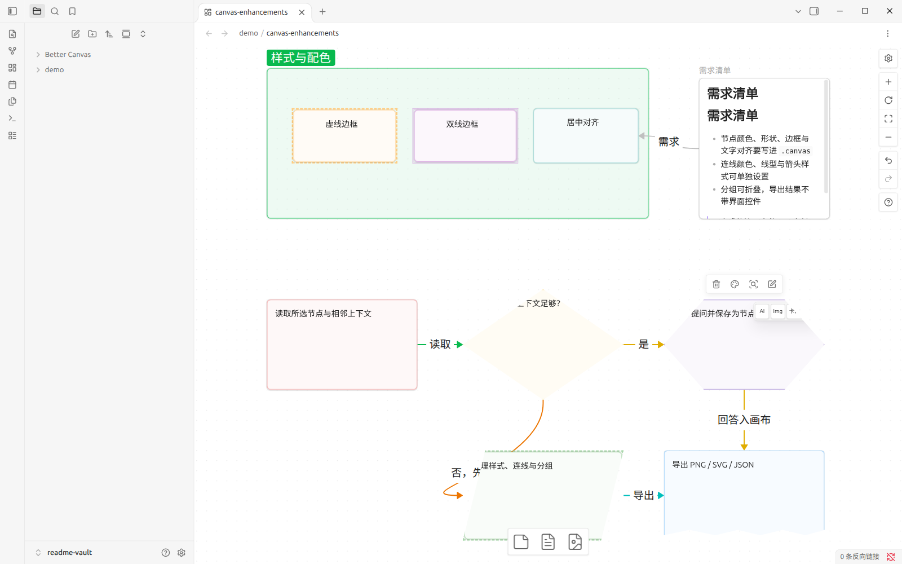
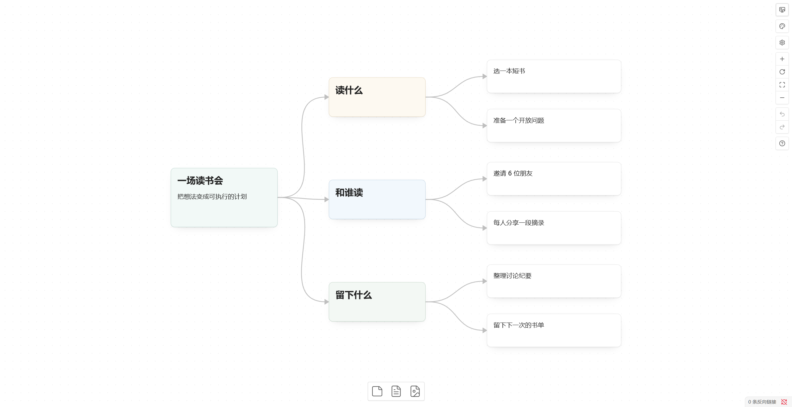
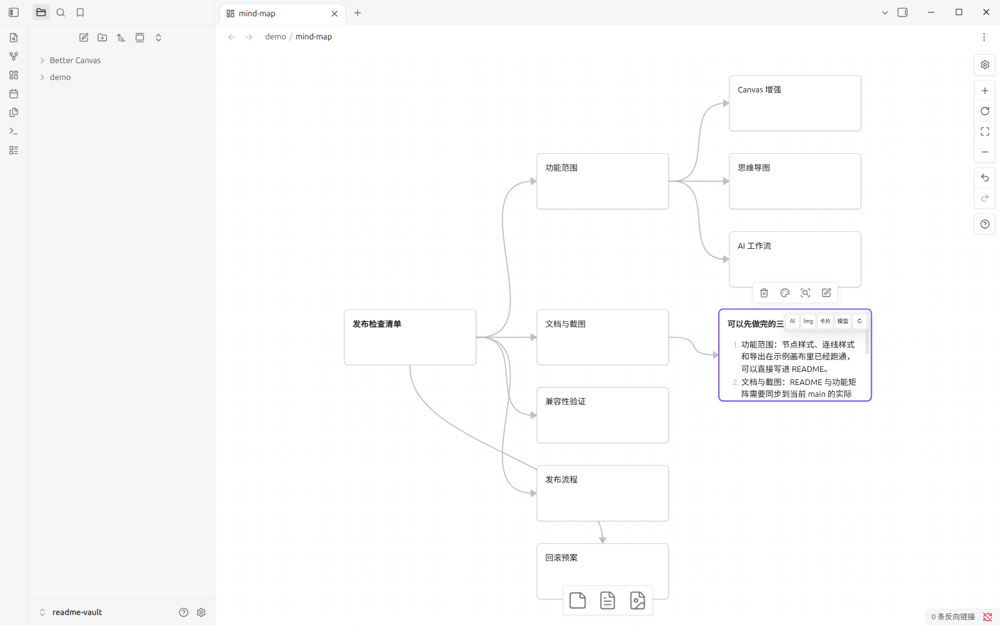
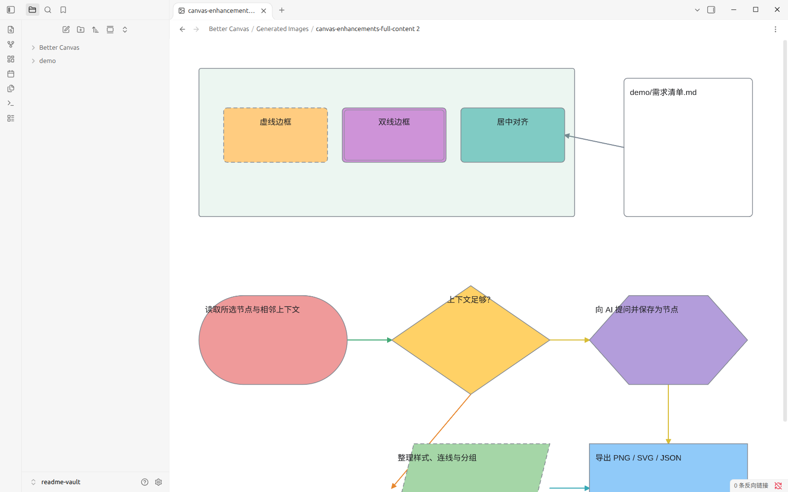

# Better Canvas

<p align="center">
  <strong>让 Obsidian Canvas 更适合编辑、整理知识与使用 AI。</strong>
</p>

<p align="center">
  
  
</p>

Better Canvas 为 Obsidian Canvas 增加更丰富的节点与连线控制、思维导图、导出工具和可配置的 AI 工作流。

> **项目状态：** 项目仍在持续整合与验证。部分功能依赖 Obsidian 内部 API；“已实现”不代表已在所有版本、主题和设备上验证。具体状态请查看 [功能整合矩阵](docs/INTEGRATION_MATRIX.md)。

## 功能一览

| 模块 | 主要能力 |
| --- | --- |
| **Canvas 编辑** | 自定义节点颜色、形状、边框和文本样式；设置连线颜色、箭头与路径；网格对齐、焦点模式、锁定交互、搜索、克隆和布局调整。 |
| **组织与导出** | 分组与折叠、Canvas Portal、节点模板、frontmatter 编辑、演示模式；导出 JSON Canvas，以及视口、全画布或选区的 PNG/SVG。 |
| **思维导图** | 创建子节点、同级节点和游离节点；从 Markdown H1 拆分节点；使用 LR、RL、TB、BT 方向布局；生成 Canvas 闪卡或 Spaced Repetition 兼容卡组。 |
| **AI 工作流** | 关联节点问答、提示词库、图片生成、网页和 YouTube 字幕导入、PDF 文本/图像上下文与批量 Prompt；支持 OpenAI-compatible、Anthropic、Gemini、MCP，以及桌面端 Codex CLI 和 OpenCode ACP。 |

详细功能状态与兼容性注意事项见 [功能整合矩阵](docs/INTEGRATION_MATRIX.md)；其他专题文档见 [文档索引](docs/README.md)。

## 界面预览

以下截图在真实 Obsidian 桌面版中运行本插件的生产构建后直接截取，不是示意图。示例内容来自合成测试 Vault，不含真实笔记、凭据或 API Key；AI 截图的回答来自本地 mock 服务，未调用真实模型。采集环境与复现步骤见 [截图说明](docs/screenshots/README.md)。实际界面会因 Obsidian 版本、主题及服务配置而异。

**Canvas 增强：** 节点颜色、形状、边框与文字对齐，以及带标签和颜色的连线。节点 AI 操作（提问、生成图片、复习闪卡、选择模型和重新生成）位于节点右键菜单中，悬停时不会再覆盖节点编辑区。预览截图展示的是迁移前的界面。

<p align="center">
  
</p>

<table>
  <tr>
    <td width="50%" valign="top">
      <strong>思维导图</strong><br />
      用“创建子节点 / 创建同级节点”生成节点树后执行“自动整理思维导图”。<br />
      
    </td>
    <td width="50%" valign="top">
      <strong>AI 工作流</strong><br />
      对选中节点提问后，回答保存为与来源节点相连的新节点。<br />
      
    </td>
  </tr>
</table>

**导出：** “导出 Canvas 全内容 PNG”按所有节点边界渲染整张画布，不含界面控件，文件写入 Vault 后可在 Obsidian 中直接打开。

<p align="center">
  
</p>

## 安装

### 方式一：下载 Release（推荐）

1. 打开 [GitHub Releases](https://github.com/OneLastHuman/obsidian-better-canvas/releases)，下载 `obsidian-better-canvas.zip`。
2. 将压缩包解压到 Vault 的 `.obsidian/plugins/` 目录。确认最终结构为：

   ```text
   <Vault>/.obsidian/plugins/obsidian-better-canvas/
   ├── main.js
   ├── manifest.json
   └── styles.css
   ```

3. 在 Obsidian 的 **设置 → 社区插件** 中重新加载插件列表，并启用 **Better Canvas**。

### 方式二：手动安装最新构建

将以下三个文件放入 `<Vault>/.obsidian/plugins/obsidian-better-canvas/`：

- [main.js](https://raw.githubusercontent.com/OneLastHuman/obsidian-better-canvas/main/main.js)
- [manifest.json](https://raw.githubusercontent.com/OneLastHuman/obsidian-better-canvas/main/manifest.json)
- [styles.css](https://raw.githubusercontent.com/OneLastHuman/obsidian-better-canvas/main/styles.css)

之后重新加载插件列表并启用插件。仓库的 `main.js` 由成功的 main 分支生产构建更新；也可以从 **Actions → Build** 下载近期构建工件（工件保留 14 天）。

### 方式三：从源码构建

需要 Node.js 22 和 npm：

```bash
git clone https://github.com/OneLastHuman/obsidian-better-canvas.git
cd obsidian-better-canvas
npm install
npm run build
```

将生成的 `main.js` 与 `manifest.json`、`styles.css` 一起复制到插件目录。

## 快速配置

- **Canvas 与思维导图：** 安装并启用插件即可使用，不需要 API Key。
- **AI 与 MCP：** 在插件设置中配置多个 AI 服务商、远程 MCP endpoint 或本地服务；删除服务商前会显示确认，删除当前服务时会说明切换目标。
- **本地 OpenCode / Codex：** 需要在桌面端预先安装并登录对应 CLI。

数值设置输入超出允许范围时会显示范围提示并标记为无效；该值不会保存，修正输入后才会应用。

配置步骤、安全说明与本地 AI 后端说明见 [AI 与 MCP 配置指南](docs/AI_SETUP.md)。完整能力清单见 [功能指南](docs/FEATURE_GUIDE.md)，详细安装方式见 [安装与构建指南](docs/INSTALLATION.md)。

## 常用快捷键

| 快捷键 | 操作 |
| --- | --- |
| `Tab` | 为选中节点创建子节点 |
| `Enter` | 为选中节点创建同级节点 |
| `Alt + ↑ / ↓ / ← / →` | 选择空间位置相邻的节点 |
| `Ctrl/Cmd + Shift + 方向键` | 按指定方向创建子节点 |

快捷键在节点选中时生效；编辑节点文本时不会拦截输入。可在插件设置中分别关闭这些快捷键，以避免与其他插件冲突。

## 开发

```bash
npm install
npm run dev
npm run typecheck
npm test
npm run build
```

| 命令 | 用途 |
| --- | --- |
| `npm run dev` | 开发构建 |
| `npm run typecheck` | TypeScript 类型检查 |
| `npm test` | 单元测试 |
| `npm run build` | 生产构建 |

CI 会检查类型、单元测试和构建产物，但不会启动 Obsidian 图形界面。涉及原生 Canvas 交互、Portal、PDF、主题/DOM 或真实 AI 请求时，仍需在目标环境中手动验证。 版本号同步、打 tag 和 GitHub Release 发布步骤见 [发版流程](docs/RELEASING.md)。

## 兼容性与隐私

- 最低要求为 Obsidian 1.5.0。部分功能使用内部 API 或 DOM 行为，升级 Obsidian 后可能需要重新验证。
- 使用 AI 时，提示词、所选节点内容及所需上下文会发送给所配置的服务。请先了解服务商的数据处理政策。
- MCP 本地 stdio 服务以当前用户权限运行，可能访问其有权访问的文件和网络。只配置可信服务，并在执行工具前检查参数。
- HTML 预览使用沙盒 iframe；仍建议只预览可信或已检查的代码。

查看 [已知限制与安全注意事项](docs/KNOWN_LIMITATIONS.md) 了解运行时风险；[功能整合矩阵](docs/INTEGRATION_MATRIX.md) 记录逐项实现与验证状态。CSS 样式预设见 [自定义样式预设指南](docs/CUSTOM_STYLE_PRESETS.md)，上游来源与许可证说明见 [致谢文档](docs/ACKNOWLEDGEMENTS.md)。

## 致谢与许可证

本项目的部分功能方向参考了 [Advanced Canvas](https://github.com/Developer-Mike/obsidian-advanced-canvas)、[Canvas MindMap](https://github.com/Quorafind/Obsidian-Canvas-MindMap) 和 [Obsidian AI Canvas](https://github.com/testy-cool/obsidian-ai-canvas)；这不代表已与上游完全兼容。许可证见 [LICENSE](LICENSE)。
