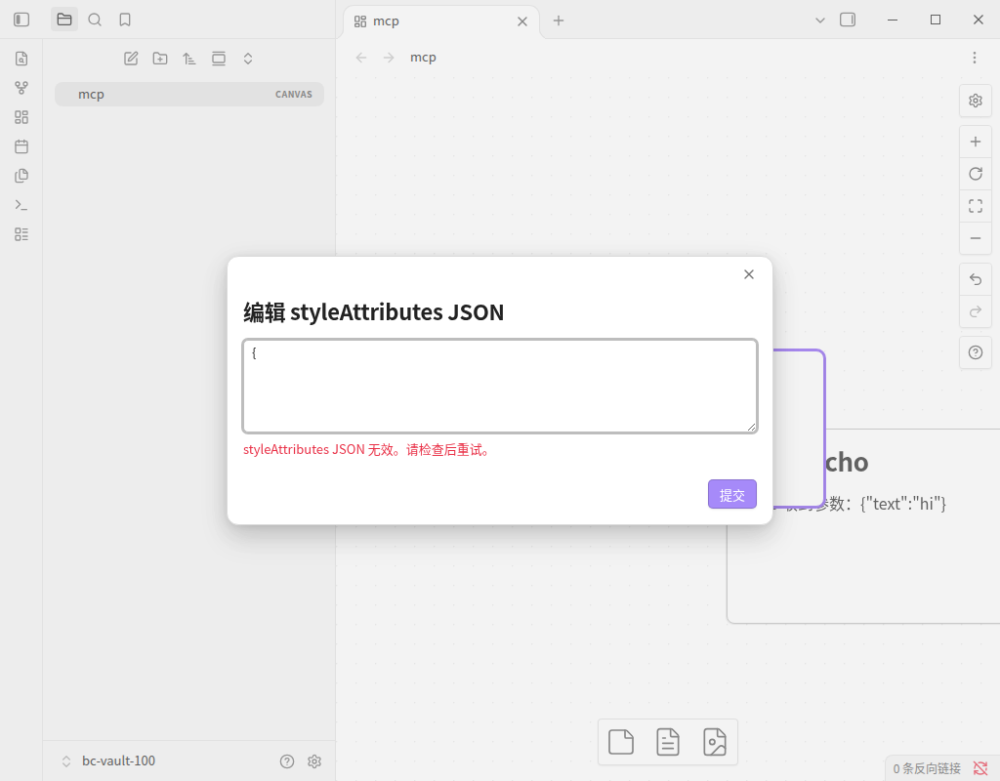
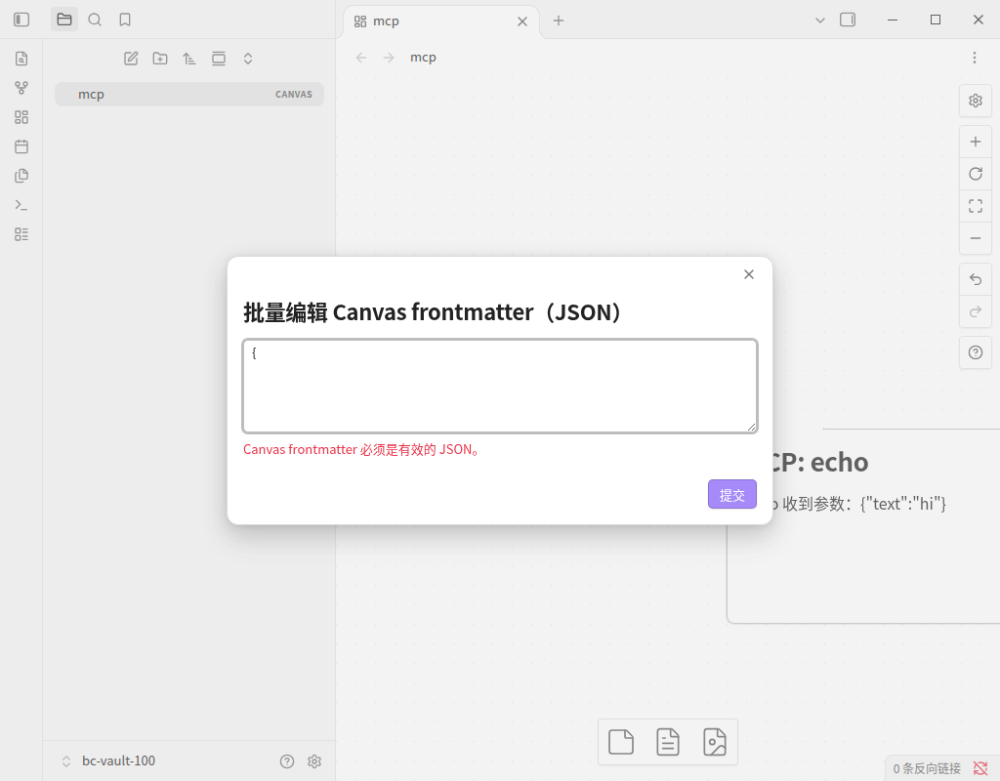
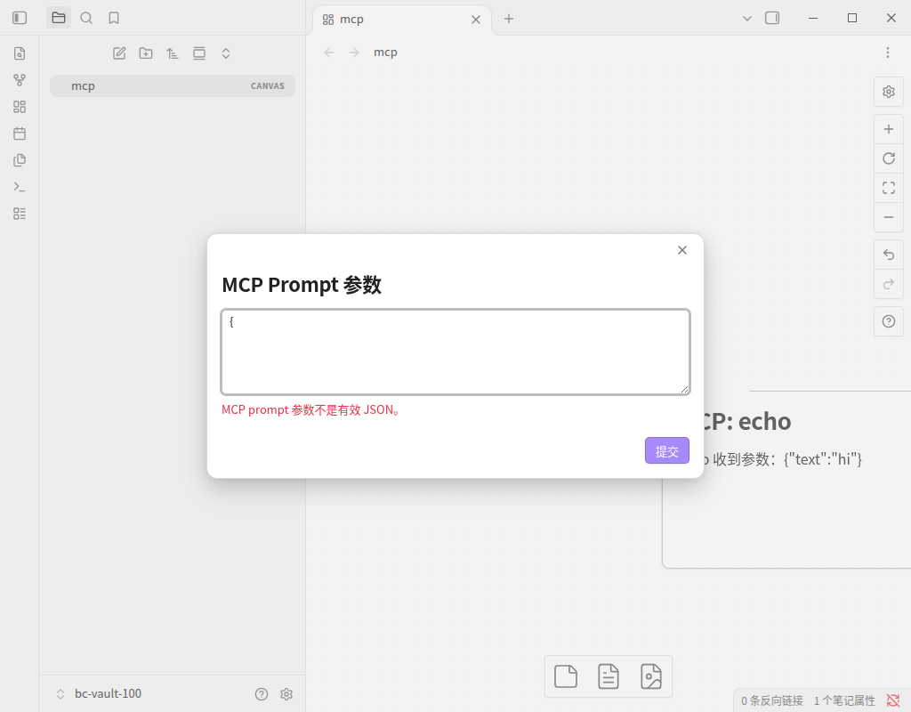

# Issue 100 — 提交无效 JSON 时提示词弹窗提前关闭

- 对应问题：[GitHub Issue #100](https://github.com/OneLastHuman/obsidian-better-canvas/issues/100)
- 被测宿主：Obsidian 1.14.4 桌面版（Linux，Xvfb 虚拟显示器）。
- 测试方式：Playwright CLI（playwright-core）通过 CDP 驱动真实 Obsidian 桌面进程。命令面板（`Ctrl+P`）输入命令显示名触发「Better Canvas: 调用远程 MCP 工具」，参数用真实键盘输入，提交用真实鼠标点击「提交」按钮；没有 mock Obsidian 界面。
- MCP 服务：本地 stdio fixture（[`mcp-fixture-server.mjs`](mcp-fixture-server.mjs)），实现 `initialize` / `tools/list` / `tools/call` / `prompts/list` / `prompts/get`，只回显收到的参数，并把每个请求写入日志。没有连接任何真实 MCP 服务或 AI 供应商。
- 隔离方式：独立测试 Vault 与隔离 `HOME`；未读取或写入真实 Vault，未提供任何 API Key。
- 测试构建：修复前使用 `origin/main` 跟踪的 `main.js`；修复后使用本分支 `npm run build` 产出的 `main.js`。两份产物分别复制进测试 Vault 并重启 Obsidian 验证，插件命令数 96，确认插件已启用。
- 基础 commit：`a8fe4f3`（origin/main，含 PR #118 合并后的 installable bundle）
- 修复前 `main.js` SHA-256：`7ab3e20100ddebb45f5eb19dd3f443ba1b6accb77667e26ff5c5dfa695c777ec`
- 修复后 `main.js` SHA-256：`53f54d8e6049377eee982ced95fb7497b1a2fe0b6ba0de4d45b584efebebab24`
- 结果：真实 UI 验收通过。修复前提交 `{` 后弹窗关闭、Notice 显示解析器原文且没有任何副作用；修复后同一输入保留弹窗与已输入文本，并显示「参数 JSON 无效。请检查后重试。」；改成合法 JSON 后工具真实执行，结果写入 Vault 中的 `.canvas`。同类 JSON 入口（styleAttributes、Canvas frontmatter、MCP Prompt 参数）行为一致。

## Playwright 截图

### 修复前：弹窗先关闭，Notice 暴露解析器原文


### 修复后：弹窗保持打开、保留输入并给出插件措辞


### 修复后：改成合法 JSON 后调用执行并写入画布


### 修复后：同类入口「编辑所选节点或连线的 styleAttributes JSON」行为一致



### 修复后：同类入口「批量编辑当前 Canvas frontmatter（JSON）」行为一致



### 修复后：同类入口「运行 MCP 提示模板并添加到画布」的参数输入行为一致



## 可验证断言

以下数值来自 CDP 运行时探针与磁盘文件，对应上面的截图：

1. 修复前提交 `{`：`.modal-container` 数量为 0（弹窗在校验前已关闭），页面 Notice 文本为 `Expected property name or '}' in JSON at position 1 (line 1 column 2)`，`.bc-prompt-error` 不存在，画布节点数仍为 1。
2. 修复后提交 `{`：`.modal-container` 数量为 1，标题「MCP 参数」，textarea 值仍为 `{`，`.bc-prompt-error` 可见且文本为「参数 JSON 无效。请检查后重试。」，Notice 数量为 0。
3. 修复后把输入改成 `{"text":"hi"}` 并提交：弹窗关闭，画布节点数由 1 变为 2，stdio fixture 日志出现 `{"method":"tools/call","params":{"name":"echo","arguments":{"text":"hi"}}}`，Vault 中 `mcp.canvas` 落盘新增文本为 `# MCP: echo\n\necho 收到参数：{"text":"hi"}` 的节点。
4. 修复后提交 `[]` 之类的非对象 JSON：提示为「输入必须是 JSON 对象，例如 {}。」，弹窗同样保持打开（由 `src/prompt-input.test.ts` 覆盖该分支）。
5. 修复后在同类入口「编辑所选节点或连线的 styleAttributes JSON」提交 `{`：弹窗保持打开，提示「styleAttributes JSON 无效。请检查后重试。」；再输入 `{"shape":"diamond"}` 时提示清除，提交后弹窗关闭且节点 `styleAttributes` 变为 `{"shape":"diamond"}`。
6. 修复后在同类入口「批量编辑当前 Canvas frontmatter（JSON）」提交 `{`：弹窗保持打开，提示「Canvas frontmatter 必须是有效的 JSON。」；改成 `{"status":"accepted"}` 提交后弹窗关闭，Vault 中 `mcp.canvas` 的 `metadata.frontmatter.status` 变为 `accepted`。
7. 修复后在同类入口「运行 MCP 提示模板并添加到画布」的参数输入提交 `{`：弹窗保持打开，提示「MCP prompt 参数不是有效 JSON。」；改成 `{"topic":"canvas"}` 提交后 stdio fixture 收到 `prompts/get`（`arguments` 为 `{"topic":"canvas"}`），结果写入新节点。
8. 测试 Vault 中安装的 `main.js` SHA-256 与本分支在基础 commit 上的构建一致：`53f54d8e6049377eee982ced95fb7497b1a2fe0b6ba0de4d45b584efebebab24`（仓库跟踪的 `main.js` 由 CI 在合并后刷新，本分支不提交构建产物）。

## 复现方式

1. `npm run build`，把 `main.js`、`manifest.json`、`styles.css` 复制进隔离测试 Vault 的 `.obsidian/plugins/obsidian-better-canvas/`。
2. 写入 `data.json`：

   ```json
   {
     "mcpTransport": "stdio",
     "mcpStdioConfig": "{\"command\":\"<node 绝对路径>\",\"args\":[\"<本目录>/mcp-fixture-server.mjs\"]}"
   }
   ```

3. 启动 Obsidian 桌面版并打开该 Vault 中的任一 `.canvas` 文件。
4. 运行「Better Canvas: 调用远程 MCP 工具」→ 确认工具名 `echo` → 在「MCP 参数」中输入 `{` → 点击「提交」。

上述数据均来自合成测试环境；截图中不包含真实用户资料、凭据或 API Key。
