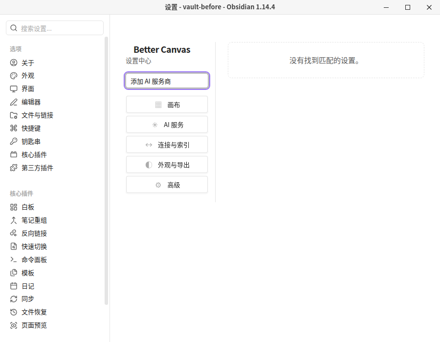
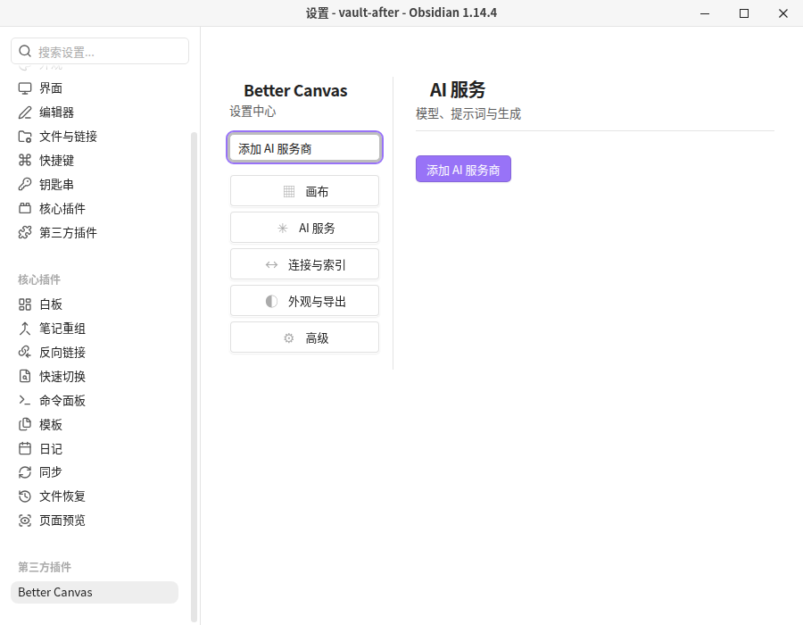
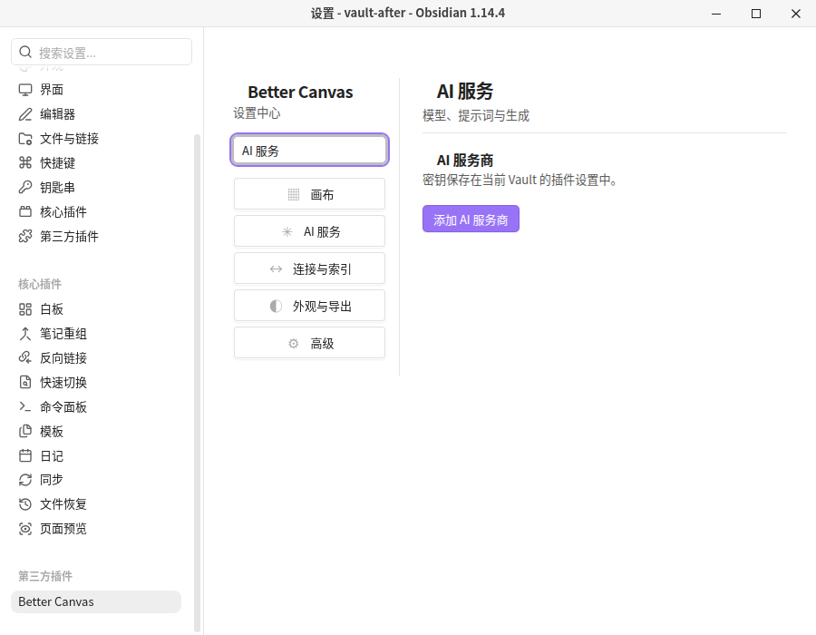
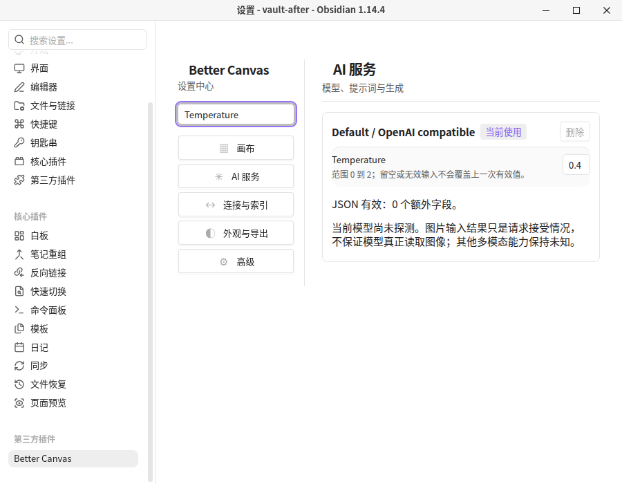

# Issue 103 — 设置搜索无法匹配分类标题和独立操作按钮

- 对应问题：[GitHub Issue #103](https://github.com/OneLastHuman/obsidian-better-canvas/issues/103)
- 被测代码 commit：`05490f02331540af4c1c6efc3947cd392f151f43`
- 修复前基线：`b9eb519bb53fcdef91fa280a5e80510ffd8f0c3f`
- 被测 Obsidian：1.14.4 桌面版（Linux AppImage，独立 Xvfb 显示器）
- 测试方式：Playwright 1.64.0 通过 CDP 操作真实 Obsidian 设置 UI；键入搜索词并读取实际 DOM 显示状态，没有使用 mock 设置页面。
- 修复后插件 `main.js` SHA-256：`b03cf9bf8d6d000a3822a94227a9617652233070b719870b47571e17852b6012`。测试 Vault 的 `.bc-build-info.json` 记录相同的 commit 和 SHA-256；运行前另外核验安装文件哈希。
- 基线插件 `main.js` SHA-256：`2d086fd8f17d4f0790838cc60b7b85404ad27d05be06f7a84a93a5e3b50f25da`。
- 测试结果：14 项检查通过；详见执行结果和逐截图溯源的 `../manifest.json` 中 `issues.103` 条目。

## 验收结果

1. 修复前，搜索「添加 AI 服务商」时显示空结果提示，AI 服务页面隐藏，但按钮仍存在于 DOM 中。
2. 修复后，同一搜索词显示 AI 服务分类和「添加 AI 服务商」按钮，空结果提示消失。
3. 搜索「AI 服务」能显示该分类；搜索「Temperature」仍能显示普通设置项。
4. 插件设置数据文件在操作前后 SHA-256 未变化，服务商配置数量不变，API Key 均为空；没有观察到外部 HTTP 请求、JavaScript 错误或控制台错误。没有触发添加服务商或模型能力探测，不涉及确认对话框。

测试使用单独的合成 Vault（`/tmp/bc-issue103-e2e/vault-before` 和 `vault-after`），未访问真实 Vault，没有真实用户数据或凭据，也没有调用真实服务商 API。

## 截图

### 01 — 修复前：搜索按钮文案显示空结果

### 02 — 修复后：独立操作按钮可搜索

### 03 — 分类标题可搜索

### 04 — 普通设置项回归对照

