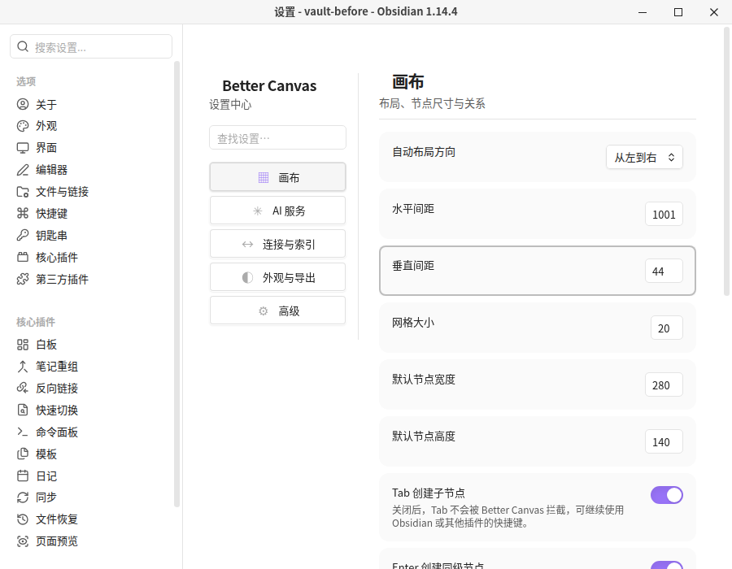
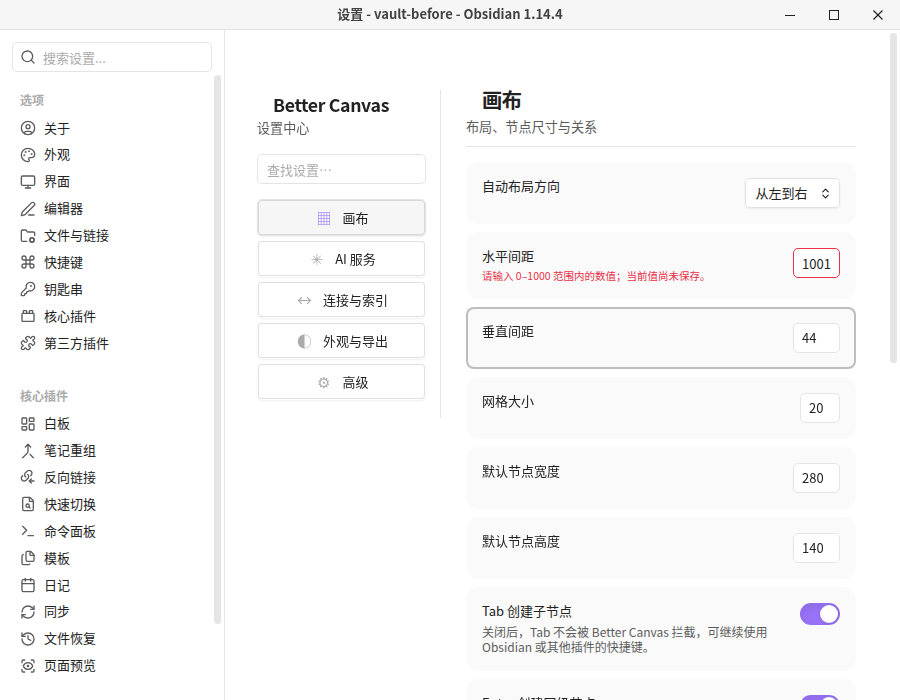

# Issue 104 — 数值设置范围校验反馈

- 对应问题：[GitHub Issue #104](https://github.com/OneLastHuman/obsidian-better-canvas/issues/104)
- 被测宿主：Obsidian 1.14.4 桌面版（Linux，Xvfb 虚拟显示器）。
- 测试方式：Playwright playwright-core 通过 CDP 操作真实 Obsidian 的 Better Canvas 设置页面；不是 mock UI。
- 隔离方式：独立临时 Vault、隔离 HOME；未读取或写入用户的真实 Vault，未提供 API Key，也未调用任何真实 AI 供应商。
- 测试构建：从修复分支工作区构建 main.js，复制到隔离 Vault 后通过 Obsidian 插件管理器禁用/启用，确认插件重载后的 UI 使用此文件。
- 基础 commit：b9eb519bb53fcdef91fa280a5e80510ffd8f0c3f，其上包含本 Issue 的工作区改动。
- 构建产物 main.js SHA-256：eefa3f0f6e03400427fc5d3005211c79f5dd498f3b376498c1fd8417d1c0c91d
- 结果：真实 UI 回归通过。修复前 1001 留在输入框中，没有 aria-invalid 或错误消息，磁盘 gapX 仍为 100；修复后相同输入显示范围错误且标记无效，磁盘仍为 100；改为 240 后错误提示清除且磁盘 gapX 持久化为 240。

## Playwright 截图

### 修复前：无提示地拒绝保存

### 修复后：显示范围错误

### 输入纠正后：错误清除并保存

## 可验证断言

1. 修复前输入 1001：浏览器 rangeOverflow=true，没有 aria-invalid、没有 .bc-settings-number-error，data.json 中 gapX 保持 100。
2. 修复后输入 1001：aria-invalid=true；关联的实时状态提示显示“请输入 0–1000 范围内的数值；当前值尚未保存。”；data.json 中 gapX 仍为 100。
3. 输入有效值 240：aria-invalid 移除、提示隐藏，data.json 中 gapX 更新为 240。
4. main.js 的 SHA-256 与被测隔离 Vault 中安装的插件文件一致：eefa3f0f6e03400427fc5d3005211c79f5dd498f3b376498c1fd8417d1c0c91d。

上述值均来自合成测试环境；截图中不包含真实用户资料、凭据或 API Key。
